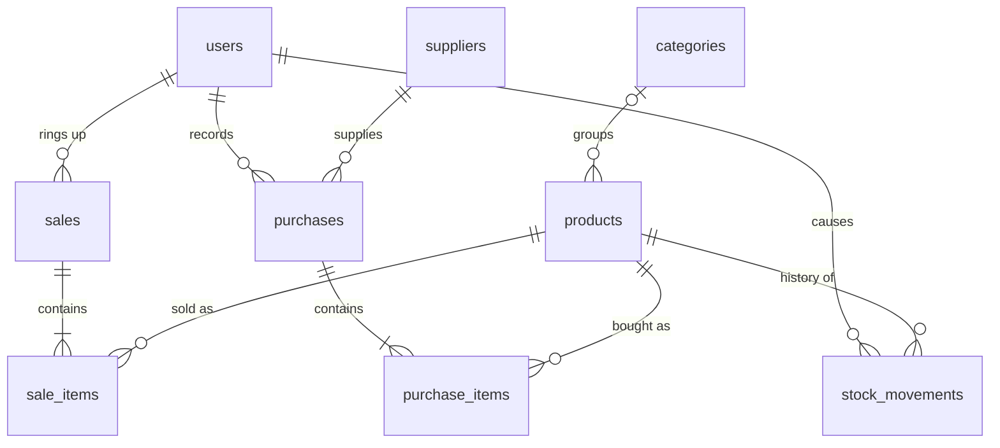

# martgo: Project Overview

martgo is a backend REST API for running a small supermarket or grocery store.
It keeps track of what the store sells, what it has on the shelf, what it buys
from suppliers, and what it sells at the checkout, and it controls who on the
staff may do each of those things.

It is a **starter project**: complete enough to run and use end to end, and small
enough to read in an afternoon and extend. There is no frontend; any client
(a web POS, a mobile app, a script) talks to it over JSON.

For setup and run commands, see the [README](../README.md).

---

## What it is used for

| Store task | How martgo handles it |
| --- | --- |
| Keep a product catalog | Products with SKU, barcode, price, cost, unit and category |
| Know what is on the shelf | Live `stock_quantity` per product, plus a low-stock list |
| Receive goods from a supplier | A **purchase** adds stock and updates each product's cost |
| Ring up a customer at the till | A **sale** checks stock, computes totals and change, and removes stock |
| Fix stock after damage or a recount | A **stock adjustment** with a required note |
| Answer "where did this stock go?" | Every stock change is logged in `stock_movements` |
| Control staff access | Three roles: admin, manager and cashier |

### Who uses it

- **Admin** (store owner or IT): manages staff accounts and can do everything else.
- **Manager**: manages the catalog, suppliers and purchases, adjusts stock, and sees every sale.
- **Cashier**: looks up products (by search or barcode scan), makes sales, and sees only their own sales.

---

## Core concepts

### Money is always an integer

Every amount (price, cost, total, discount, paid, change) is a `BIGINT` in the
**smallest currency unit**. `4500` means 45.00. Floats are never used, so totals
never drift by fractions of a cent. Clients format the number for display.

### Stock only changes through recorded events

`stock_quantity` cannot be edited directly. It changes only through:

| Event | Effect on stock | `stock_movements.reason` |
| --- | --- | --- |
| Purchase | `+quantity` | `purchase` |
| Sale | `-quantity` | `sale` |
| Stock adjustment | `±quantity_change` | `adjustment` |

Each event writes a movement row with who did it, when, and a reference to the
sale or purchase. Replaying a product's movements explains its current stock.

### Products are deactivated, not deleted

`DELETE /products/{id}` sets `is_active = false`. Old sales still point to the
product, so history stays intact. Inactive products cannot be sold.

---

## Main workflows

### 1. Receiving goods (purchase)

```
Manager → POST /purchases {supplier_id, items:[{product_id, quantity, unit_cost}]}
```

In one database transaction:

1. Check the supplier exists.
2. Lock the product rows (`SELECT … FOR UPDATE`, in id order).
3. Compute each line total and the purchase total.
4. Insert the purchase and its items.
5. For each item: add the quantity to stock, set the product's `cost` to the new
   `unit_cost`, and write a `purchase` stock movement.

If any step fails, nothing is saved.

### 2. Selling at the checkout (sale)

```
Cashier → POST /sales {payment_method, paid_amount, discount, items:[{product_id, quantity}]}
```

In one database transaction:

1. Merge duplicate lines (two scans of the same item become one line).
2. Lock the product rows in id order, so two tills selling the same item cannot
   both take the last unit and cannot deadlock.
3. For each line: the product must exist and be active, and there must be enough stock.
4. **Prices come from the database**, never from the client.
5. `subtotal = Σ price × qty`, `total = subtotal − discount`.
6. Settle payment (rules below) and compute `change_amount`.
7. Insert the sale and items (the product name is copied onto each item as a snapshot).
8. Remove the stock and write a `sale` movement per line.

### 3. Correcting stock (adjustment)

```
Manager → POST /products/{id}/stock-adjustments {quantity_change: -1, note: "damaged"}
```

Locks the product, refuses any change that would make stock negative, applies
it, and logs an `adjustment` movement with the note.

---

## Business rules

**Sales**

- At least one item; every quantity must be greater than 0.
- Payment method: `cash`, `card` or `ewallet`.
- `discount` must be between 0 and the subtotal.
- **Cash:** `paid_amount` must be at least the total; the difference is returned as change.
- **Card / e-wallet:** charged exactly the total. Send `paid_amount: 0` (or omit it)
  to mean "the total"; any other amount that is not the total is rejected.
- Not enough stock returns `409 Conflict` with the available quantity.

**Purchases**

- At least one item; quantity greater than 0; `unit_cost` 0 or more (free goods are allowed).
- A product may appear only once per purchase.
- Supplier and every product must exist.

**Products**

- `sku` is required and unique; `barcode` is optional and unique.
- `price` must be greater than 0; `cost` and `reorder_level` must be 0 or more.
- A product is "low stock" when it is active and `stock_quantity <= reorder_level`.

**Users**

- Emails are stored in lower case and must be unique.
- Passwords are 8–72 characters (bcrypt's limit) and are stored only as bcrypt hashes.
- Admins cannot deactivate their own account or change their own role, so the
  store can never lock out its last admin by accident.
- A deactivated user cannot log in.

**Suppliers and categories**

- A supplier that has purchases cannot be deleted (`409`).
- Deleting a category keeps its products; they simply lose the category.

---

## Access control

Authentication uses a JWT access token from `POST /api/v1/auth/login`, sent as
`Authorization: Bearer <token>`. The token carries the user id and role and is
valid for `JWT_TTL` (default 24h).

| Area | admin | manager | cashier |
| --- | :---: | :---: | :---: |
| Log in, view own profile | ✓ | ✓ | ✓ |
| Manage users | ✓ | | |
| View categories and products, barcode lookup, low stock | ✓ | ✓ | ✓ |
| Create, edit or delete categories and products | ✓ | ✓ | |
| Stock adjustments, stock movement history | ✓ | ✓ | |
| Suppliers and purchases | ✓ | ✓ | |
| Create sales | ✓ | ✓ | ✓ |
| View sales | all | all | own only |

---

## API reference

Base path: `/api/v1`. All bodies are JSON. Unknown fields are rejected.

### Health

| Method | Path | Description |
| --- | --- | --- |
| GET | `/healthz` | `{"status":"ok"}` if the database is reachable, otherwise `503` |

### Auth

| Method | Path | Description |
| --- | --- | --- |
| POST | `/auth/login` | `{email, password}` → `{access_token, token_type, expires_at, user}` |
| GET | `/auth/me` | The logged-in user |

### Users (admin)

| Method | Path | Description |
| --- | --- | --- |
| GET | `/users` | List users (paginated) |
| POST | `/users` | Create: `{email, password, full_name, role}` |
| GET | `/users/{id}` | Get one user |
| PATCH | `/users/{id}` | Partial update: any of `full_name, role, is_active, password` |

### Categories

| Method | Path | Roles | Description |
| --- | --- | --- | --- |
| GET | `/categories` | all | List (paginated) |
| GET | `/categories/{id}` | all | Get one |
| POST | `/categories` | admin, manager | Create: `{name, description}` |
| PUT | `/categories/{id}` | admin, manager | Replace |
| DELETE | `/categories/{id}` | admin, manager | Delete (`204`) |

### Suppliers (admin, manager)

| Method | Path | Description |
| --- | --- | --- |
| GET | `/suppliers` | List (paginated) |
| POST | `/suppliers` | Create: `{name, contact_name, email, phone, address}` |
| GET | `/suppliers/{id}` | Get one |
| PUT | `/suppliers/{id}` | Replace |
| DELETE | `/suppliers/{id}` | Delete (`409` if it has purchases) |

### Products

| Method | Path | Roles | Description |
| --- | --- | --- | --- |
| GET | `/products` | all | List; filters `search`, `category_id`, `is_active` |
| GET | `/products/low-stock` | all | Active products at or below their reorder level |
| GET | `/products/barcode/{barcode}` | all | Lookup for barcode scanners |
| GET | `/products/{id}` | all | Get one |
| POST | `/products` | admin, manager | Create (stock starts at 0) |
| PUT | `/products/{id}` | admin, manager | Replace all editable fields |
| DELETE | `/products/{id}` | admin, manager | Deactivate (`204`) |
| POST | `/products/{id}/stock-adjustments` | admin, manager | `{quantity_change, note}` |
| GET | `/products/{id}/stock-movements` | admin, manager | Stock history, newest first |

`search` matches name or SKU (partial, case-insensitive) or an exact barcode.

### Sales

| Method | Path | Description |
| --- | --- | --- |
| POST | `/sales` | Create a sale (the cashier is the logged-in user) |
| GET | `/sales` | List, newest first; admins and managers may filter by `cashier_id` |
| GET | `/sales/{id}` | Sale with its items |

### Purchases (admin, manager)

| Method | Path | Description |
| --- | --- | --- |
| POST | `/purchases` | Receive goods: `{supplier_id, invoice_no, note, items}` |
| GET | `/purchases` | List, newest first; filter by `supplier_id` |
| GET | `/purchases/{id}` | Purchase with its items |

### Conventions

**Pagination.** List endpoints take `?limit=` (default 20, max 100) and `?offset=`:

```json
{
  "data": [ ... ],
  "pagination": { "limit": 20, "offset": 0, "total": 57 }
}
```

**Errors.** Every error has the same shape:

```json
{ "error": "insufficient stock for \"Fresh Milk 1L\": requested 999, available 21" }
```

| Status | Meaning |
| --- | --- |
| 400 | Invalid input (validation, malformed JSON, unknown field) |
| 401 | Missing, invalid or expired token; wrong login |
| 403 | Logged in, but the role is not allowed |
| 404 | Resource or route not found |
| 409 | Conflict: duplicate SKU or email, not enough stock, record still in use |
| 500 | Unexpected error (details are logged, never returned) |

---

## Data model



| Table | Purpose |
| --- | --- |
| `users` | Staff accounts: email, bcrypt hash, role, active flag |
| `categories` | Product groups such as Dairy or Bakery |
| `suppliers` | Who the store buys from |
| `products` | Catalog plus current `stock_quantity`, `price`, latest `cost` |
| `sales` / `sale_items` | Receipts; items keep a snapshot of the name and unit price |
| `purchases` / `purchase_items` | Goods received; items keep the unit cost paid |
| `stock_movements` | Append-only log of every stock change |

The database backs up the application rules with `CHECK` constraints: stock never
below 0, `total = subtotal − discount`, `change = paid − total`, and positive quantities.

---

## How a request flows through the code

```
HTTP request
  → middleware   request id, logging, panic recovery, JWT auth, role check
  → handler      decode and validate JSON, read URL and query params
  → service      business rules, transactions
  → store / db   sqlc-generated SQL queries via pgx
  ← handler      JSON response, or {"error": ...} mapped from the error kind
```

Services return typed errors from `internal/apperr` (validation, not found,
conflict, and so on), and `httpx.HandleError` turns them into status codes. Services
never know about HTTP, and handlers never contain SQL.

### Project layout

| Path | Contents |
| --- | --- |
| `cmd/api` | Server entry point: config, wiring, graceful shutdown |
| `cmd/migration` | Runs the goose migrations embedded in the binary |
| `migrations/` | SQL schema migrations plus the Go admin-seed migration |
| `internal/config` | Reads environment variables |
| `internal/domain` | Shared constants: roles, payment methods, stock reasons |
| `internal/apperr` | Application error kinds |
| `internal/auth` | bcrypt hashing, JWT creation and parsing |
| `internal/db` | sqlc output (generated, do not edit) and `queries/*.sql` |
| `internal/store` | Wraps sqlc with transactions and Postgres error helpers |
| `internal/service` | Business logic and unit tests |
| `internal/httpx` | JSON, error, validation and pagination helpers |
| `internal/middleware` | Auth, roles, request logging, panic recovery |
| `internal/handler` | HTTP handlers and the route table |

### Tech stack

| Concern | Choice |
| --- | --- |
| Language | Go |
| Router | chi |
| Database | PostgreSQL 17, pgx / pgxpool |
| Queries | sqlc (type-safe Go generated from SQL) |
| Migrations | goose |
| Auth | JWT (HS256) + bcrypt |
| Validation | go-playground/validator |
| Logging | log/slog, JSON output |
| Dev tooling | Docker Compose, Air (hot reload), Makefile |
| Tests | testify (table-driven unit tests for the sale and purchase services) |

---

## Configuration

All settings come from environment variables (see `.env.example`). The Makefile
loads `.env` if it exists, otherwise `.env.example`.

| Variable | Default | Purpose |
| --- | --- | --- |
| `HTTP_ADDR` | `:8080` | Listen address |
| `DATABASE_URL` | required | Postgres connection string |
| `JWT_SECRET` | required, 32+ chars | Token signing key |
| `JWT_TTL` | `24h` | Token lifetime |
| `LOG_LEVEL` | `info` | `debug`, `info`, `warn`, `error` |
| `SHUTDOWN_TIMEOUT` | `10s` | Time allowed for in-flight requests on shutdown |
| `ADMIN_EMAIL`, `ADMIN_PASSWORD`, `ADMIN_NAME` | from `.env` | Used once by the seed migration |
| `POSTGRES_*` | `martgo`, port `5433` | Docker Compose database settings |

---

## Current limitations

These are deliberate gaps for a starter project and good next features:

- **No refunds or voids.** A completed sale cannot be reversed.
- **No reports.** No daily totals, sales by cashier or payment method, or best sellers.
- **Tokens cannot be revoked.** A deactivated user's existing token works until it expires.
- **Single store, single currency.** No branches, taxes or multi-currency.
- **No login rate limiting or CORS.** Add these before exposing the API publicly.
- **Tests cover only the sale and purchase services.** Handlers and SQL have no automated tests yet.
